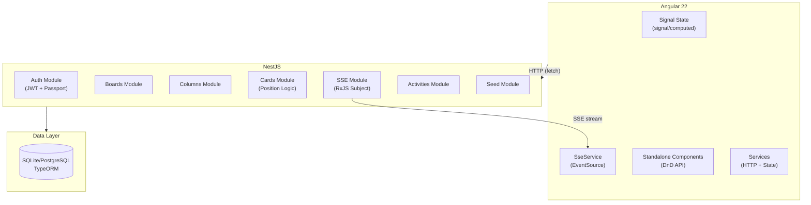

# Architecture — Kanban Board

## System Overview



## Data Flow

### Card Drag & Drop Flow
```
User drags card → Optimistic UI update → PATCH /api/cards/:id/position
  → Backend recalculates positions (source + dest columns)
  → SSE broadcast: card:moved to all connected clients
  → On error: UI reverts to original state + toast notification
```

### Auth Flow
```
User submits login → POST /api/auth/login
  → Backend validates credentials (bcrypt)
  → Returns JWT token
  → Frontend stores token in localStorage
  → AuthGuard checks token on protected routes
  → Token sent as Bearer header on all API calls
```

## Why This Architecture

- **Standalone components** — Angular 22's default approach, no NgModules needed
- **Signal-first state** — All component state is signal-based (not RxJS Subject-based) for simplicity
- **SSE over WebSocket** — Server-Sent Events are simpler to implement (one-directional), sufficient for board updates, and work with standard HTTP
- **Feature modules** — Each domain (boards, columns, cards, activities) is its own NestJS module with clear boundaries
- **Vertical slices** — Components include their full template in one file, keeping related code together
