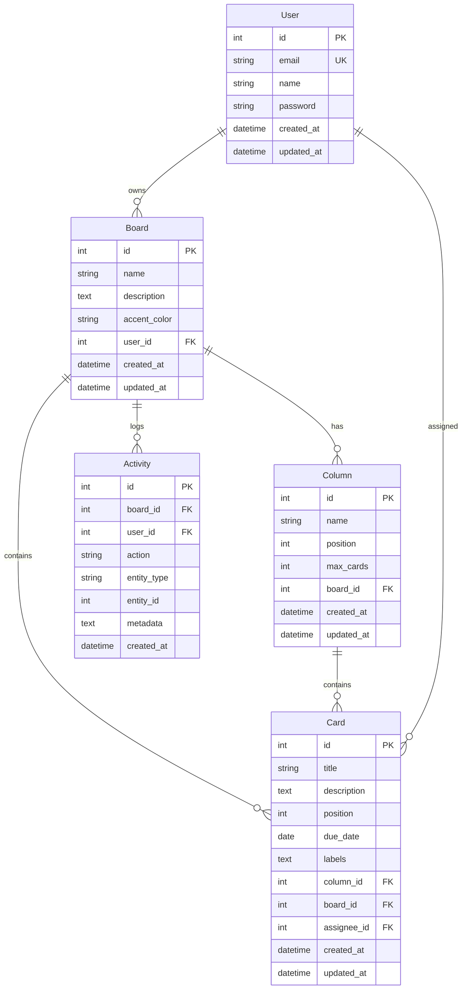

# Database Schema — Kanban Board

## Entity Relationship Diagram

## Schema Design Decisions

### Labels as JSON String
Stored as a JSON array string (e.g., `'["high","feature"]'`) in a TEXT column. This avoids a separate label-pivot table while keeping the ability to query. PostgreSQL's JSON operators can query them natively; SQLite uses LIKE.

### Position as Integer
Uses simple integer positions (0-based). When moving a card, positions are recalculated via SQL UPDATE queries for source and destination columns. This is simpler and more portable than fractional indexing or linked lists.

### snake_case Column Names
All columns use `snake_case` with TypeORM `@Column({ name: 'user_id' })` mappings. This ensures PostgreSQL compatibility and consistent querying.

## Migration Strategy

Development uses SQLite with `synchronize: true` (TypeORM auto-syncs schema). For production Neon/PostgreSQL:

1. Generate migration files using TypeORM CLI
2. Apply migrations during deployment
3. Remove `synchronize: true` in production

## Neon Compatibility

The schema uses only standard SQL types (SERIAL, VARCHAR, TEXT, INTEGER, DATE, TIMESTAMP, BOOLEAN) that work identically on SQLite and PostgreSQL. Indexes are defined for all foreign keys and commonly queried columns.
